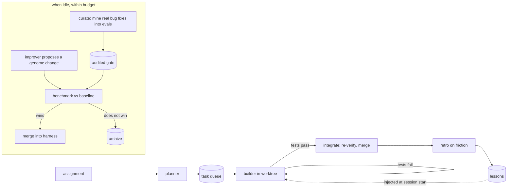

# ASH: the Automated Self-improving Harness

[](https://github.com/joeyda3rd/Automated-self-improving-harness/actions/workflows/ci.yml)

-brightgreen)


**ASH turns Claude Code into an unattended software builder that measures itself and keeps only the changes that make it better.**

You hand it an assignment. It plans the work into tasks, builds each one in an isolated git worktree, proves it with your test suite, and merges it. When it's idle, it grows its own benchmark from real bug fixes in open-source projects, proposes changes to its own prompts, skills and tools, and benchmarks each proposal. A change is merged only if it wins under a paired, noise-aware comparison. Everything runs under one supervisor process with a hard budget ceiling.

It is built entirely from Claude Code's own primitives: headless sessions, plugins, skills, subagents, hooks, session resume, structured output and budgets. A small orchestrator in standard-library Python ties them together.

```bash
ash -C ~/code/myapp init --verify "pytest -q"
ash -C ~/code/myapp assign "Add CSV export to the reports page, with tests"
ash -C ~/code/myapp daemon        # builds the work, then improves itself while idle
```

---

## Contents

- [Why ASH](#why-ash)
- [How it works](#how-it-works)
- [Quick start](#quick-start)
- [What it has done so far](#what-it-has-done-so-far)
- [Safety model](#safety-model)
- [Commands](#commands)
- [Configuration](#configuration)
- [Repository layout](#repository-layout)
- [Limitations and roadmap](#limitations-and-roadmap)
- [Documentation](#documentation) · [Contributing](#contributing) · [License](#license)

## Why ASH

Coding agents are good at single tasks. Running one *continuously* exposes problems a single task never shows:

- **"Done" drifts.** Agents declare victory early, weaken tests, or commit broken builds.
- **Nobody is watching.** Loops crash, containers restart, duplicate jobs run, and budgets disappear.
- **Improvement is anecdotal.** A prompt tweak "feels better", but nothing measures whether it is.

ASH answers each with mechanism instead of instructions:
- **A deterministic kernel decides what counts as done.** Your test command gates every result. Merges are re-verified. Diffs that delete or skip tests are rejected.
- **A supervisor** holds a single-instance lock, writes a heartbeat, resumes after restarts and stops at its budget.
- **A benchmark ratchet** keeps a change only when it measurably wins. The harness cannot touch the benchmark, the grader or the rules.

## How it works



The design rests on one split:

| Kernel: fixed, humans change it | Genome: evolved by the harness |
|---|---|
| orchestrator (`ash/`), guard and gate hooks, evals and their grader, the reporter and auditor prompts, `harness.json` | role prompts, skills, subagents, builder tools (`plugin/roles`, `plugin/skills`, `plugin/agents`, `plugin/bin`), `docs/` |

**Build loop.** It runs the plan, then for each task: build in a worktree, verify, integrate, review.
- **Gating "done":** a PreToolUse hook refuses a "done" result until your test command passes. The orchestrator then re-runs the tests itself, resuming the same session with the failure if they fail.
- **Integration:** the integrator merges the latest base into the task branch, verifies again, checks test integrity (no deleted tests, no skip markers), and merges with `--no-ff`.

**Fast learning.** Runs with friction get a retrospective. It writes short lessons with IDs; later sessions are given them, retros rate them, and harmful or ineffective lessons are deleted.

**Slow learning.**
- **The proposal:** the improver studies evidence: run metrics, failed benchmark runs and their transcripts (never the hidden checks), and earlier rejected ideas. It proposes one change to the genome, in prose or as a tool.
- **The benchmark:** the change runs on an audited gate of real-bug evals, smoke canaries first, then the rest.
- **The verdict:** it is kept only if more evals improve than regress, or results are identical and it is measurably cheaper on most evals. Evals with mixed history count only when they flip completely. Rejected candidates are archived for re-testing.

**Self-growing benchmark.** `ash curate` turns real upstream fixes into evals:
1. **Mine** commits whose tests fail before the fix and pass after.
2. **Report:** write a user-style bug report, in full and narrow forms.
3. **Screen** the new evals against the current harness.
4. **Audit** each failure for fairness.
5. **Gate:** the fair failures that aren't noisy form the gate.

The supervisor runs curation whenever the gate is too small to carry signal.

## Quick start

**Requirements:**
- the [Claude Code](https://code.claude.com) CLI, authenticated;
- `git` and Python 3.9+;
- `pytest`, only if you use the bundled pytest-based evals.

Run ASH in a container or VM: build sessions run with `bypassPermissions`, with ASH's guard hook as the safety layer.

```bash
git clone https://github.com/joeyda3rd/Automated-self-improving-harness && cd Automated-self-improving-harness
pip install -e .            # or: export PATH="$PWD/bin:$PATH"
ash doctor                  # pre-flight: CLI, git, budget, gate, kernel/genome split
```

Set a spending ceiling in `harness.json` (`budget_usd_total`), then:

```bash
ash -C ~/code/myapp init --verify "npm test"            # any git repo, or an empty directory
ash -C ~/code/myapp assign @feature.md                   # or drop .md files into ~/code/myapp/.ash/inbox/
ash -C ~/code/myapp daemon enable && ash -C ~/code/myapp daemon --ensure
ash status                                               # queue + daemon heartbeat
ash report                                               # success, cost and turns per harness version
```

For an always-on deployment, run `ash daemon --ensure --if-enabled` from cron or a CI schedule; it is a no-op while a daemon is alive. See [docs/OPERATIONS.md](docs/OPERATIONS.md).

## What it has done so far

Everything below is from real runs. The full lab notebook is [docs/RESEARCH.md](docs/RESEARCH.md).

**Building software**

| Run | Work | Result |
|---|---|---|
| Greenfield | a static site generator from a one-page brief (Markdown, templates, tags, RSS, drafts, errors, tests) | planned into 8 dependent tasks, **all merged first try, $1.73**, 1,116 lines; passed an independent acceptance probe |
| Brownfield | pagination and a sitemap added to that codebase, without hints about its code | 3 tasks, **all merged first try, $0.96**; every requirement verified independently |

**Benchmark (111 evals).** 16 synthetic tasks, plus 95 evals built from real upstream fixes in Python-Markdown, more-itertools, sqlparse and pypa/packaging (mostly 2025–2026 commits).
- Each eval is validated: it fails on the buggy parent and passes with the upstream fix.
- Benchmark runs are offline, so builders cannot look up the fix.

| Report style (same hidden upstream tests) | Pass rate |
|---|---|
| generous report that spells out the rule | ~98% |
| narrow, one-example report, the way users actually file bugs | **58%** |

Narrow failures are audited for fairness: 6 of 16 were judged fair (a careful maintainer would have caught them), and only fair, non-noisy failures gate self-improvement.

**Self-improvement, honestly**
- **17 benchmarked proposals; 1 accepted, by the daemon with no human involved.** It trimmed the build procedure and cut cost per run by **11%** ($0.193 → $0.172) with identical results on every gate eval.
- **The other 16 were rejected.** Prose changes, a diff tool, higher effort and stricter review did not move the hard evals. A "high effort" change that first looked like a win was reversed once the noise-aware rule showed both of its gains were noise.
- **The failure mode is real and stubborn.** The builder fixes what is reported but misses closely related cases. ASH now measures it reliably; moving it is open work.

**Bugs the harness found in itself by being run for real** (all fixed):
- the stop gate never fired under `--json-schema`;
- failed tool calls were never counted;
- child sessions inherited the parent's session ID and effort level;
- a system-wide `packaging` shadowed the code under test;
- installed Pygments broke evals;
- build artefacts were committed into projects;
- the daemon idled instead of improving;
- canaries piled up;
- commits used an unverified identity.

## Safety model

- **Protected kernel.** The PreToolUse guard denies improver edits to kernel paths, and a diff check rejects any candidate that touches them. The improver cannot edit how evals are written, run or graded.
- **Hidden evals.** Hidden checks and benchmark records are unreadable to builder, eval and improver sessions. Eval runs get no web tools and no network commands.
- **Contained sessions.** Writes stay inside the session's worktree. There is no `git push`, `sudo` or `curl | sh`, and orchestrator state is off-limits.
- **Test integrity.** Merges with deleted tests, net-removed test cases or new skip markers are rejected unless the task asks for them.
- **Budgets.** Every session is capped and logged. `budget_usd_total` is a hard ceiling, and concurrent sessions reserve their caps before starting. While build work is queued, self-improvement may take at most `meta_budget_share` of spend.
- **Operations.** One supervisor runs at a time (an flock released on death), with a heartbeat, `ash pause`, a circuit breaker after repeated failures, and restart-safe resumable benchmarks.

## Commands

| Command | Purpose |
|---|---|
| `ash init / assign / add` | attach a project, give it work (or use `.ash/inbox/`) |
| `ash run [--until-empty] [--no-improve]` | work the queue in the foreground |
| `ash daemon [enable / stop / status / --ensure]` | the supervisor: build, curate, improve, sleep |
| `ash status`, `ash report`, `ash lessons`, `ash doctor` | queue and daemon state, learning curve, memory, pre-flight |
| `ash curate [mine / make / report / screen / audit / gate]` | grow the benchmark from real bug fixes |
| `ash improve [--list / --retry ID]` | one improvement cycle, or re-test an archived candidate |
| `ash eval [--only NAME] [--repeats N] [--effort L]` | benchmark the harness or a candidate plugin |
| `ash pause / resume` | halt after the current step, or clear a halt |

## Configuration

`harness.json` is part of the kernel. Highlights:

| Key | Default | Meaning |
|---|---|---|
| `budget_usd_total` | *set this* | hard ceiling on all spend |
| `budget_usd_per_run` / `eval_budget_usd_per_task` | 5 / 2 | per-session caps |
| `effort` | `{"default": "medium"}` | `--effort` per role |
| `meta_budget_share` | 0.4 | max share of spend for self-improvement while build work is queued |
| `improve_evals` / `improve_eval_repeats` | `["@gate"]` / 2 | which evals gate a change, and runs per eval |
| `min_gate_discriminating` | 8 | below this, the daemon curates before it improves |
| `min_cycle_budget_usd` / `min_curate_budget_usd` | 5 / 7 | budget floors for a cycle and a curation pass |
| `retro` | `"auto"` | review only runs with friction |
| `mutable_paths` | genome paths | what the improver may edit |

The projects to mine evals from are listed in `evals/sources.json`.

## Repository layout

```
ash/                 orchestrator (kernel): engine, sessions, git, evals, improve, curate, daemon, CLI
ash/prompts/         reporter and auditor prompts (kernel: they write and grade the benchmark)
plugin/              the Claude Code plugin every session loads
  hooks/             guard, gate, telemetry, transcript capture (kernel)
  roles/ skills/ agents/ bin/   the genome the harness evolves
evals/               benchmark: tasks/, gate.json, sources.json, prepare/ (kernel)
mods/harness-console/  Claude Code mod: /ash pane and status line
tests/               offline test suite (fake claude binary) and eval validator
docs/                ARCHITECTURE, OPERATIONS, RESEARCH (lab notebook)
```

## Limitations and roadmap

- **The hard eval failures have not moved yet.** Nothing tried has fixed the builder's tendency to fix only the reported case. Ideas worth testing: tools that generate and check variants of the input (not replay existing ones), cross-checking with a second model, and an archive of variants to branch from (Darwin Gödel Machine style) instead of greedy hill climbing.
- **The gate is small.** 4 discriminating evals plus 4 canaries; most new narrow evals pass. Mining more projects, and turning the harness's own failed real builds into evals, would sharpen it.
- **Two runs per eval is noisy.** Noise-aware acceptance helps, but more repeats cost money.
- **No always-on host is bundled.** Pair `ash daemon --ensure` with cron, CI or a scheduled cloud session.
- **Python-first evals.** The build loop is language-agnostic; the bundled benchmark sources are Python (plus one Node eval).

## Documentation

- [docs/ARCHITECTURE.md](docs/ARCHITECTURE.md): the design, primitive by primitive.
- [docs/OPERATIONS.md](docs/OPERATIONS.md): running it unattended, watching it, tuning it.
- [docs/RESEARCH.md](docs/RESEARCH.md): every experiment, number and reversal, in order.
- [CONTRIBUTING.md](CONTRIBUTING.md): kernel vs genome, tests, evals, spending safely.

## Contributing

Issues and PRs are welcome. Read [CONTRIBUTING.md](CONTRIBUTING.md) first. The short version:
- keep the kernel and the genome separate;
- run `python3 -m unittest discover -s tests -q` (offline, no API key needed);
- validate any new eval;
- show benchmark numbers for genome changes.

## License

[MIT](LICENSE) © 2026 Joey Marino
